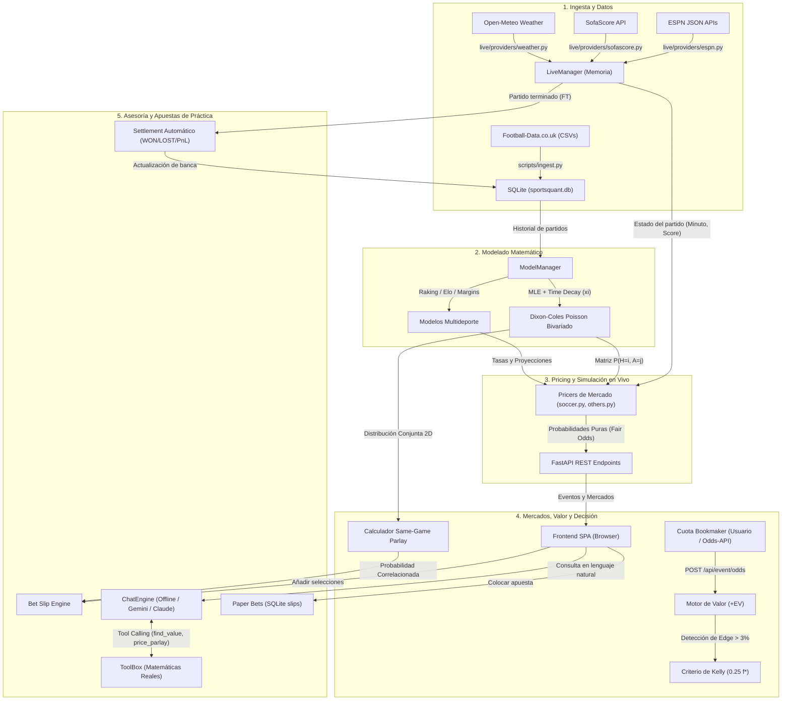

# ANTIGRAVITY_MIGRATION.md — Documento Maestro de Traspaso y Arquitectura

> **Documento de migración técnica y especificación operativa de SportsQuant v2 para agentes autónomos y desarrolladores en Google Antigravity.**

---

## 1. Visión General del Proyecto

### 1.1. Nombre y Propósito
* **Nombre del Proyecto**: **SportsQuant v2** (Motor de Predicción Cuantitativa y Sportsbook de Práctica) acompañado del repositorio de investigación satélite **sports-betting**.
* **Propósito**: 
  Plataforma analítica y cuantitativa de grado institucional para modelado estadístico deportivo, pricing de mercados en tiempo real, valoración de apuestas combinadas (*Same-Game Parlays* correlacionados), detección de valor esperado positivo ($+EV$), gestión de banca basada en el Criterio de Kelly Fraccional ($0.25 f^*$) y asesoría conversacional basada en modelos matemáticos (sin alucinaciones generativas).
* **Restricción Ética y de Seguridad**: Cero integración con dinero real, pasarelas de pago o automatización de cuentas en casas de apuestas. Todo el sistema opera exclusivamente como un entorno de simulación cuantitativa (*paper betting*).

### 1.2. Tecnologías y Lenguajes
* **Lenguaje Principal**: Python 3.10+ (Backend, modelos y pipelines).
* **Framework Web / API**: FastAPI (ASGI) + Uvicorn (servidor de alto rendimiento).
* **Almacenamiento Local**: SQLite3 en modo WAL (*Write-Ahead Logging*) para concurrencia multi-hilo sin bloqueos en Windows/Linux.
* **Computación Numérica y Estadística**: NumPy, SciPy (optimización MLE, funciones de distribución bivariada), Pandas (manipulación de datos tabulares históricos).
* **Frontend**: HTML5 semántico, CSS3 moderno (modo oscuro con paleta inspirada en terminales financieras) y JavaScript Vanilla asíncrono (cero dependencias de Node.js, Webpack o npm).
* **Modelos de Lenguaje (Opcionales)**: Google Gemini API (`gemini-2.5-flash`), Anthropic Claude API (`claude-sonnet-5`), integrados mediante *Tool Calling* puro.

### 1.3. Dependencias Críticas
Definidas en `@sports-quant-ai-v2/requirements.txt`:
```txt
fastapi>=0.110.0
uvicorn[standard]>=0.25.0
pydantic>=2.5.0
python-multipart>=0.0.9
numpy>=1.26.0
pandas>=2.0.0
scipy>=1.11.0
pyyaml>=6.0.0
requests>=2.31.0
python-dotenv>=1.0.0
pytest>=8.0.0
```

---

## 2. Mapa de Archivos y Directorios

El workspace en `d:\Proyecto_Parley` consta de dos entidades:
1. **`sports-quant-ai-v2/`**: El núcleo de producción de la aplicación web y modelos cuantitativos (sistema objetivo de migración).
2. **`sports-betting-main/`**: Biblioteca de referencia open source (*georgedouzas/sports-betting*) con herramientas de dataloading y conectores MCP para scikit-learn.

### 2.1. Árbol Estructurado del Proyecto Objetivo

```
d:/Proyecto_Parley/
├── ANTIGRAVITY_MIGRATION.md           # [Este archivo] Especificación maestra de traspaso
├── APIS_Y_SCRIPTS.md                  # Documentación exhaustiva de endpoints y scripts
├── HOW_TO_USE.md                      # Manual de usuario para no programadores
├── walkthrough.md                     # Bitácora histórica del bootstrap matemático v1
├── h.md                               # Especificación maestra de fases de construcción
├── sports-quant-ai-v2/                # CARPETA RAÍZ DE PRODUCCIÓN
│   ├── run.py                         # Punto de entrada único del servidor web y UI
│   ├── requirements.txt               # Dependencias Python fijadas
│   ├── .env.example                   # Plantilla de variables de entorno (claves opcionales)
│   ├── config/                        # Configuraciones desacopladas (YAML y JSON)
│   │   ├── settings.yaml              # Configuración de red, banca, Kelly y sondeo
│   │   ├── leagues.json               # Mapeo de competiciones, códigos ESPN y Football-Data
│   │   └── accounts_twitter.json      # Clasificación de cuentas X por tiers de confianza
│   ├── data/                          # Persistencia local (gitignored en producción)
│   │   ├── sportsquant.db             # Base de datos SQLite (partidos, cuotas, slips)
│   │   └── seed/                      # Snapshots de semillas iniciales
│   ├── docs/                          # Documentación formal y teoría matemática
│   │   ├── model_guide.pdf            # Monografía académica compilada
│   │   └── model_guide.tex            # Fuente LaTeX del fundamento biofísico/estadístico
│   ├── prompts/                       # Prompts de desarrollo para agentes IA (Fases 01-05)
│   ├── scratch/                       # Scripts de exploración y pruebas preliminares
│   │   ├── test_caribbean.py          # Pruebas de scoreboards de béisbol caribeño en ESPN
│   │   └── test_winter_dates.py       # Pruebas de barrido de fechas para ligas invernales
│   ├── scripts/                       # Scripts de mantenimiento y CLI
│   │   └── ingest.py                  # CLI de ingesta de datos históricos de fútbol
│   ├── sportsquant/                   # PAQUETE PRINCIPAL DE LA APLICACIÓN
│   │   ├── settings.py                # Clase Settings (inyección de YAML + .env)
│   │   ├── events.py                  # Dataclass Event y enumeración SPORTS
│   │   ├── mathutil.py                # Utilidades de Poisson y combinatoria
│   │   ├── names.py                   # Normalizador canónico y fuzzy matcher de equipos
│   │   ├── odds.py                    # Algoritmos Shin de-vig, Kelly, Fair Odds y CLV
│   │   ├── chat/                      # Capa conversacional y tool calling
│   │   │   ├── engine.py              # Router offline + Clientes Gemini / Anthropic
│   │   │   └── tools.py               # ToolBox (puente entre chat y matemáticas)
│   │   ├── data/                      # Capa de almacenamiento y datos sintéticos
│   │   │   ├── store.py               # DAO SQLite con PRAGMA WAL y esquema relacional
│   │   │   └── synthetic.py           # Generador de datos sintéticos para tests sin red
│   │   ├── engines/                   # Motores de pricing y derivación de mercados
│   │   │   ├── soccer.py              # Pricer de fútbol (Dixon-Coles a 1X2, OU, Asian, Props)
│   │   │   └── others.py              # Pricers multideporte (Baloncesto, MLB, Tenis, etc.)
│   │   ├── ingest/                    # Conectores de ingesta externa
│   │   │   └── footballdata.py        # Parser de CSVs de Football-Data.co.uk
│   │   ├── inplay/                    # Dinámica durante el partido (live)
│   │   │   ├── generic.py             # Decaimiento temporal genérico
│   │   │   └── soccer.py              # Calibración de intensidad y aceleración in-play
│   │   ├── live/                      # Sondeo concurrente y orquestación en tiempo real
│   │   │   ├── manager.py             # LiveManager (hilo background, caché y refresco)
│   │   │   └── providers/             # Proveedores externos de datos
│   │   │       ├── espn.py            # ESPN JSON Scoreboards, rosters y lesionados
│   │   │       ├── sofascore.py       # SofaScore eventos en vivo
│   │   │       ├── thesportsdb.py     # TheSportsDB fixtures y ligas
│   │   │       ├── weather.py         # Open-Meteo geocodificación y clima al kickoff
│   │   │       └── sim_demo.py        # Generador determinista de partidos demo
│   │   ├── markets/                   # Estructura de cuotas y distribuciones
│   │   │   ├── schema.py              # Definición de selecciones y grupos de mercados
│   │   │   └── scoredist.py           # ScoreDist (distribución de probabilidad conjunta)
│   │   ├── models/                    # Algoritmos predictivos fundamentales
│   │   │   ├── dixon_coles.py         # Dixon-Coles Poisson bivariado con parámetro rho
│   │   │   ├── elo.py                 # Modelo Elo estándar y logístico
│   │   │   ├── margin_model.py        # Modelos Gaussianos para márgenes de victoria
│   │   │   ├── racket.py              # Cadena de Markov para tenis (game/set/match)
│   │   │   └── rate_model.py          # Modelos de tasas Poisson univariadas
│   │   ├── services/                  # Servicios transversales
│   │   │   ├── backtester.py          # Backtester walk-forward sin look-ahead bias
│   │   │   ├── ml_ensemble.py         # Ensamble de modelos
│   │   │   └── model_manager.py       # ModelManager (gestión y reajuste periódico)
│   │   ├── social/                    # Extracción de señales de redes sociales
│   │   │   └── extractor.py           # XClient y SocialExtractor (Twitter API v2)
│   │   └── web/                       # Capa de presentación y servicio web
│   │       ├── app.py                 # API REST FastAPI y lifecycle lifespan
│   │       └── static/                # Interfaz de usuario (SPA)
│   │           ├── index.html         # Estructura del dashboard
│   │           ├── css/app.css        # Hoja de estilos moderna
│   │           └── js/app.js          # Lógica cliente, reactividad y llamadas API
│   └── tests/                         # Suite de pruebas unitarias (Pytest)
│       ├── test_api.py                # Validación de endpoints FastAPI
│       ├── test_dixon_coles.py        # Identificabilidad e integrabilidad de Dixon-Coles
│       ├── test_ingestion.py          # Parsing de Football-Data
│       ├── test_inplay_soccer.py      # Ajustes de cuotas en vivo
│       ├── test_model_manager.py      # Transición de modelos ok a low-confidence
│       ├── test_odds.py               # Desmargenado Shin, Kelly y EV
│       ├── test_racket.py             # Matrices estocásticas de tenis
│       └── test_scoredist.py          # Muestreo e integrales conjuntas 2D SGP
└── sports-betting-main/               # REPOSITORIO DE APOYO (Scikit-Learn Sports Betting Toolkit)
```

### 2.2. Rutas Exactas de Archivos Críticos
* `@sports-quant-ai-v2/run.py`
* `@sports-quant-ai-v2/scripts/ingest.py`
* `@sports-quant-ai-v2/config/settings.yaml`
* `@sports-quant-ai-v2/config/leagues.json`
* `@sports-quant-ai-v2/sportsquant/settings.py`
* `@sports-quant-ai-v2/sportsquant/data/store.py`
* `@sports-quant-ai-v2/sportsquant/live/manager.py`
* `@sports-quant-ai-v2/sportsquant/live/providers/espn.py`
* `@sports-quant-ai-v2/sportsquant/models/dixon_coles.py`
* `@sports-quant-ai-v2/sportsquant/engines/soccer.py`
* `@sports-quant-ai-v2/sportsquant/engines/others.py`
* `@sports-quant-ai-v2/sportsquant/chat/engine.py`
* `@sports-quant-ai-v2/sportsquant/chat/tools.py`
* `@sports-quant-ai-v2/sportsquant/web/app.py`
* `@sports-quant-ai-v2/sportsquant/web/static/js/app.js`

---

## 3. Archivos Funcionales Clave

### 3.1. Lanzador de la Aplicación
* **Ruta**: `@sports-quant-ai-v2/run.py`
* **Propósito**: Configura el entorno de ejecución, valida importaciones, levanta el servidor web ASGI Uvicorn en `127.0.0.1:8000` y lanza automáticamente el navegador del usuario.
* **Entradas**: Variables de entorno (`SQ_PORT`, `SQ_HOST`, `SQ_PROVIDERS`) y `config/settings.yaml`.
* **Salidas**: Proceso servidor en ejecución continua; interfaz gráfica abierta en navegador.
* **Comando exacto**:
  ```bash
  python run.py
  ```

### 3.2. CLI de Ingesta Histórica
* **Ruta**: `@sports-quant-ai-v2/scripts/ingest.py`
* **Propósito**: Descarga conjuntos de datos oficiales desde Football-Data.co.uk, limpia registros, parsea cuotas de cierre históricas (Pinnacle, Bet365) y escribe las tablas en SQLite.
* **Entradas**: Parámetros de línea de comandos (`--all`, `--div`, `--seasons`, `--years`).
* **Salidas**: Tablas `matches` y `results` persistidas en `data/sportsquant.db`.
* **Comandos exactos**:
  ```bash
  # Ingesta estándar (Big-5 europeas, 3 temporadas)
  python scripts/ingest.py

  # Ingesta completa de todas las ligas configuradas
  python scripts/ingest.py --all

  # Ingesta por divisiones específicas
  python scripts/ingest.py --div E0 SP1 D1 --seasons 2023-2024 2024-2025
  ```

### 3.3. Servidor y Endpoints Web
* **Ruta**: `@sports-quant-ai-v2/sportsquant/web/app.py`
* **Propósito**: Expone la API REST que alimenta el frontend. Gestiona el ciclo de vida de la aplicación (`lifespan`), inicializa `LiveManager`, `ModelManager`, `Store` y `ChatEngine`.
* **Entradas**: Solicitudes HTTP (JSON) de la interfaz web.
* **Salidas**: Respuestas JSON con cuotas calculadas, boletos valorados, estado de modelos y respuestas del chat.
* **Comando de ejecución directa (alternativo a run.py)**:
  ```bash
  uvicorn sportsquant.web.app:app --host 127.0.0.1 --port 8000 --reload
  ```

### 3.4. Orquestador de Eventos en Tiempo Real
* **Ruta**: `@sports-quant-ai-v2/sportsquant/live/manager.py`
* **Propósito**: Hilo en segundo plano que sondea periódicamente a ESPN (`espn.py`), SofaScore y Open-Meteo Weather. Mantiene la memoria de eventos vivos y programados, gestiona cachés de cuotas y liquida automáticamente apuestas de práctica (*settlement*).
* **Entradas**: Sondeo de endpoints públicos en intervalos configurables (`poll_live_seconds`, `poll_schedule_seconds`).
* **Salidas**: Estructuras en memoria `Dict[str, Event]` y actualización de estados en base de datos.

### 3.5. Núcleo Matemático Dixon-Coles
* **Ruta**: `@sports-quant-ai-v2/sportsquant/models/dixon_coles.py`
* **Propósito**: Ajuste de máxima verosimilitud (MLE con SciPy `minimize`) para el modelo Poisson bivariado de Dixon y Coles (1997). Modela los parámetros de ataque ($\alpha_i$), defensa ($\beta_j$), ventaja de local ($\gamma$) y el parámetro de correlación en marcadores bajos ($\rho$).
* **Entradas**: DataFrame histórico de partidos con fechas, equipos y goles.
* **Salidas**: Objeto `DixonColes` con parámetros ajustados capaz de generar la matriz de probabilidad conjunta $P(H=i, A=j)$ para $i, j \in [0, 8]$.

### 3.6. Motor de Pricing de Fútbol
* **Ruta**: `@sports-quant-ai-v2/sportsquant/engines/soccer.py`
* **Propósito**: Toma las tasas Poisson del modelo ($\lambda, \mu$) o la matriz de Dixon-Coles y deriva de forma matemáticamente exacta todos los mercados del partido: 1X2, Over/Under (de 0.5 a 4.5 goles), Ambos Equipos Marcan (BTTS), Hándicaps Asiáticos, Resultado al Descanso/Final (HT/FT) y Marcador Exacto.
* **Entradas**: Tasas de gol proyectadas y estado del partido (`SoccerState`: minuto, marcador actual).
* **Salidas**: Diccionario jerárquico de mercados listos para visualización y apuestas.

### 3.7. Motor Conversacional y Asistente
* **Ruta**: `@sports-quant-ai-v2/sportsquant/chat/engine.py`
* **Propósito**: Procesa consultas de usuarios. Opera en modo offline mediante reglas deterministas o en modo online mediante LLMs (Gemini / Claude) ejecutando *Tool Calling* hacia `ToolBox`. Prohíbe que el LLM invente números.
* **Entradas**: Texto del usuario y contexto de sesión.
* **Salidas**: Respuestas explicativas en Markdown acompañadas de métricas de valor (+EV) y gestión de banca.

### 3.8. Pruebas de Exploración de Béisbol Caribeño
* **Ruta**: `@sports-quant-ai-v2/scratch/test_caribbean.py`
* **Propósito**: Verifica los scoreboards de ESPN para las ligas invernales de Venezuela (LVBP), Dominicana (LIDOM), México (LMP), Puerto Rico (LBPRC) y Serie del Caribe.
* **Comando exacto**:
  ```bash
  python scratch/test_caribbean.py
  ```

---

## 4. Flujo de Trabajo (Workflow) y Esquema del Sistema

### 4.1. Ciclo de Vida de los Datos



### 4.2. Descripción Operativa Paso a Paso
1. **Fase de Ingesta**: `scripts/ingest.py` descarga resultados históricos y los aloja en la tabla `matches` de `sportsquant.db`.
2. **Fase de Ajuste de Modelos**: Al arrancar `run.py`, `ModelManager` toma hasta 3 temporadas con ponderación de decaimiento temporal exponencial ($\xi = 0.0019$, vida media $\approx 1$ año) y ajusta los parámetros de Dixon-Coles por máxima verosimilitud (MLE).
3. **Fase de Sondeo en Vivo**: `LiveManager` arranca un hilo en segundo plano que consulta concurrentemente cada 15 segundos los marcadores activos de ESPN y SofaScore, además del clima del estadio mediante Open-Meteo.
4. **Fase de Pricing Bajo Demanda**: Cuando el usuario navega a un partido en la UI, el sistema calcula de inmediato la distribución de marcadores $P(H=i, A=j)$ y deriva las cuotas justas de decenas de mercados en menos de 20 milisegundos.
5. **Fase de Detección de Valor (+EV) y SGP**: 
   - Si el usuario ingresa cuotas de su casa de apuestas (o provienen de The Odds API), el desmargenador de Shin extrae la probabilidad implícita del mercado y la compara con la del modelo. Si la ventaja (*edge*) supera el 3%, se alerta al usuario y se calcula el stake óptimo con Kelly Fraccional ($0.25 f^*$).
   - Si el usuario arma un parlay con selecciones del mismo partido, el motor integra la matriz 2D conjunta en lugar de multiplicar ingenuamente probabilidades marginales.
6. **Fase de Liquidación (*Settlement*)**: Cuando un partido en vivo pasa a estado `finished`, el hilo liquidador evalúa las apuestas de práctica abiertas (`slips`), determina si fueron ganadas o perdidas y actualiza el balance de la banca.

---

## 5. Estado Actual y Oportunidades de Optimización

Al realizar la auditoría profunda de la arquitectura actual, se detectaron los siguientes puntos de fricción técnicos y áreas de mejora que el agente autónomo en Antigravity debe abordar:

### 5.1. Cuellos de Botella y Problemas Detectados

| Componente | Archivo Actual | Problema Técnico Detectado | Impacto |
| :--- | :--- | :--- | :--- |
| **Pricers Multideporte** | `@sportsquant/engines/others.py` | Archivo monolítico de más de 600 líneas que agrupa 9 deportes totalmente dispares (Tenis, MMA, Voleibol, Waterpolo, Béisbol, Baloncesto, Hockey, NFL). | Dificulta mantenimiento, tests aislados y escalabilidad de modelos específicos por deporte. |
| **Proveedor ESPN** | `@sportsquant/live/providers/espn.py` | Archivo de 509 líneas que contiene diccionarios hardcodeados de traducción de nombres (`carib_map`) y calendarios fijos (`CARIBBEAN_SLATES`). | Viola el principio de separación de configuración y código. |
| **Motor de Chat** | `@sportsquant/chat/engine.py` | 521 líneas. Mezcla el router regex offline, clientes HTTP directos a Gemini y Anthropic, y gestión de sesiones en memoria RAM. | Si el servidor se reinicia o se escala a múltiples workers, se pierden las conversaciones y el estado de los slips. |
| **Sincronía en Red** | `@sportsquant/live/manager.py` | Utiliza la librería síncrona `requests` dentro de un `ThreadPoolExecutor` en un hilo daemon, mientras FastAPI opera sobre un event loop asíncrono. | Uso ineficiente de hilos, posible contención del GIL y bloqueos esporádicos en picos de latencia de red. |
| **Frontend Monolítico** | `@sportsquant/web/static/js/app.js` | Archivo único de más de 43 KB (~1200 líneas) en JavaScript sin módulos ES6. Mezcla renderizado DOM, WebSockets/polling, lógica de apuestas y chat. | Dificulta agregar componentes interactivos o depurar errores de UI. |
| **Sobrescritura en Base de Datos** | `@sportsquant/data/store.py` | `save_matches` utiliza `d.to_sql("matches", c, if_exists="replace")`, recreando toda la tabla en vez de aplicar operaciones `UPSERT` incrementales. | Ineficiente si se ingieren ligas de forma individual; puede borrar ligas previamente cargadas. |

### 5.2. Hoja de Ruta de Optimización Recomendada para el Agente en Antigravity

1. **Modularización de Motores Deportivos**:
   - Dividir `@sportsquant/engines/others.py` en submódulos especializados:
     - `sportsquant/engines/court/tennis.py`
     - `sportsquant/engines/combat/mma.py`
     - `sportsquant/engines/diamond/baseball.py`
     - `sportsquant/engines/timed/basketball.py`
     - `sportsquant/engines/timed/american_football.py`
2. **Extracción de Slates y Mapeos a Configuración**:
   - Mover `CARIBBEAN_SLATES` y `carib_map` desde `@sportsquant/live/providers/espn.py` hacia `config/baseball_slates.json` y `config/team_aliases.json`.
3. **Migración a Cliente HTTP Asíncrono (`httpx`)**:
   - Reemplazar `requests` por `httpx.AsyncClient` en los proveedores de red (`espn.py`, `sofascore.py`, `weather.py`, `engine.py`) para integrarse nativamente con el bucle de eventos de FastAPI sin necesidad de `ThreadPoolExecutor`.
4. **Persistencia de Sesiones en SQLite**:
   - Migrar el diccionario `ChatEngine.sessions` a una tabla relacional en `sportsquant.db` (`CREATE TABLE IF NOT EXISTS chat_sessions (...)`), asegurando que las sesiones sobrevivan a reinicios del servidor.
5. **Transición a Inserción Incremental (`UPSERT`)**:
   - Refactorizar `Store.save_matches` para utilizar `INSERT INTO matches ... ON CONFLICT(id) DO UPDATE`, preservando el histórico multiligas sin riesgo de truncado accidental.
6. **Modularización del Frontend con ES Modules**:
   - Separar `@sportsquant/web/static/js/app.js` en módulos nativos del navegador (`<script type="module">`):
     - `modules/api.js` (Llamadas REST).
     - `modules/slip.js` (Lógica del boleto).
     - `modules/chat.js` (Componente de chat).
     - `modules/render.js` (Manipulación del DOM).

---

## 6. Instrucciones de Handover (Reglas Operativas para el Nuevo Entorno)

Cualquier agente autónomo o ingeniero que tome el control de este proyecto en Antigravity **DEBE CUMPLIR ESTRICTAMENTE** las siguientes directrices:

### Regla 1 — Cero Sesgo de Anticipación (*Look-Ahead Bias*)
Bajo ninguna circunstancia se debe permitir que una característica (*feature*) o cálculo de cuota utilice información generada con posterioridad a la hora de inicio oficial del evento ($t_{\text{feature}} \le t_{\text{kickoff}}$). Todos los backtests deben ser estrictamente secuenciales (*walk-forward*).

### Regla 2 — Integridad Matemática Absoluta en Respuestas
Los números presentados al usuario (probabilidades, cuotas justas, valor esperado y tamaño de apuesta) **DEBEN SER CALCULADOS EXCLUSIVAMENTE POR CÓDIGO PYTHON** (`ToolBox`). Los modelos de lenguaje (Gemini / Claude) tienen prohibido estimar o alucinar probabilidades; su única función es explicar y dar formato a los cálculos devueltos por las herramientas.

### Regla 3 — Cero Apuestas Reales
Queda terminantemente prohibido incorporar integraciones con billeteras cripto, pasarelas de pago, scrapers de inicio de sesión o automatizaciones de clic en casas de apuestas reales. El sistema es y seguirá siendo un banco de pruebas analítico con capital virtual (*paper bankroll*).

### Regla 4 — Independencia de Claves Externas (Modo Desconectado)
La plataforma debe seguir siendo 100% funcional sin requerir la presencia de un archivo `.env`. Si no hay claves configuradas:
* El chat debe operar fluidamente mediante el enrutador determinista offline.
* Los mercados deben calcularse a partir de los modelos locales o mediante cuotas implícitas calculadas por el sistema.
* Las llamadas a APIs externas fallidas deben degradar con suavidad (*fail-soft*), mostrando alertas claras en lugar de generar errores no capturados (*tracebacks*) en la interfaz.

### Regla 5 — Gestión de Rutas y Entorno Virtual
* Todas las referencias a rutas deben construirse usando `pathlib.Path` de forma relativa a la raíz del paquete (`ROOT = Path(__file__).resolve().parent.parent`). Prohibido introducir rutas absolutas locales fijas como `C:\...` o `/home/...`.
* Todos los paquetes y scripts deben ejecutarse dentro del entorno virtual Python correspondiente (`.venv`), validando dependencias con `pip install -r requirements.txt`.

### Regla 6 — Integridad del Almacenamiento Local
* La base de datos `data/sportsquant.db` almacena el histórico local y las apuestas de práctica. No debe modificarse directamente mediante comandos SQL manuales no versionados. Cualquier cambio de esquema debe añadirse de forma retrocompatible dentro de la constante `SCHEMA` en `@sportsquant/data/store.py`.

---

## 7. Verificación de Arranque Rápido

Para validar la migración exitosa en el nuevo entorno, ejecute los siguientes pasos:

1. **Instalación de dependencias**:
   ```bash
   pip install -r requirements.txt
   ```
2. **Ejecución de la suite de pruebas unitarias**:
   ```bash
   pytest tests/ -v
   ```
   *(Todos los tests deben pasar en verde sin advertencias críticas).*
3. **Ingesta de prueba**:
   ```bash
   python scripts/ingest.py --div E0 --seasons 2023-2024
   ```
4. **Lanzamiento de la plataforma**:
   ```bash
   python run.py
   ```
   *(Debe responder código HTTP 200 en `http://127.0.0.1:8000` y mostrar la consola web con partidos activos y cuotas calculadas).*
